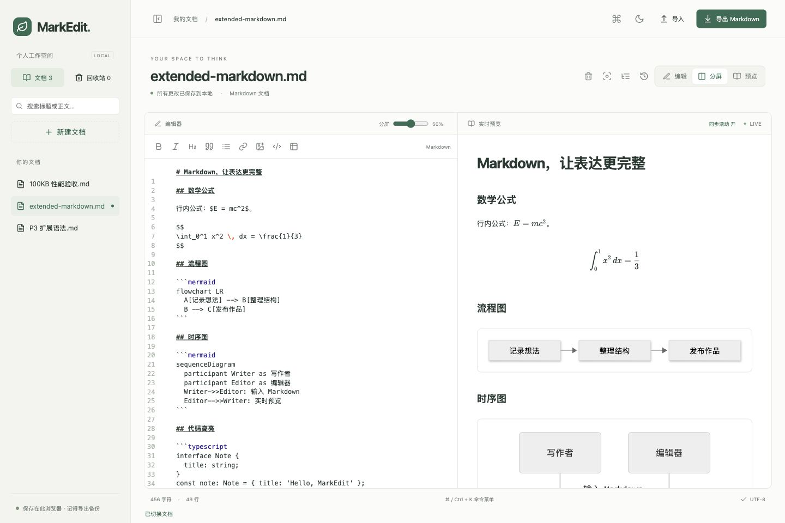
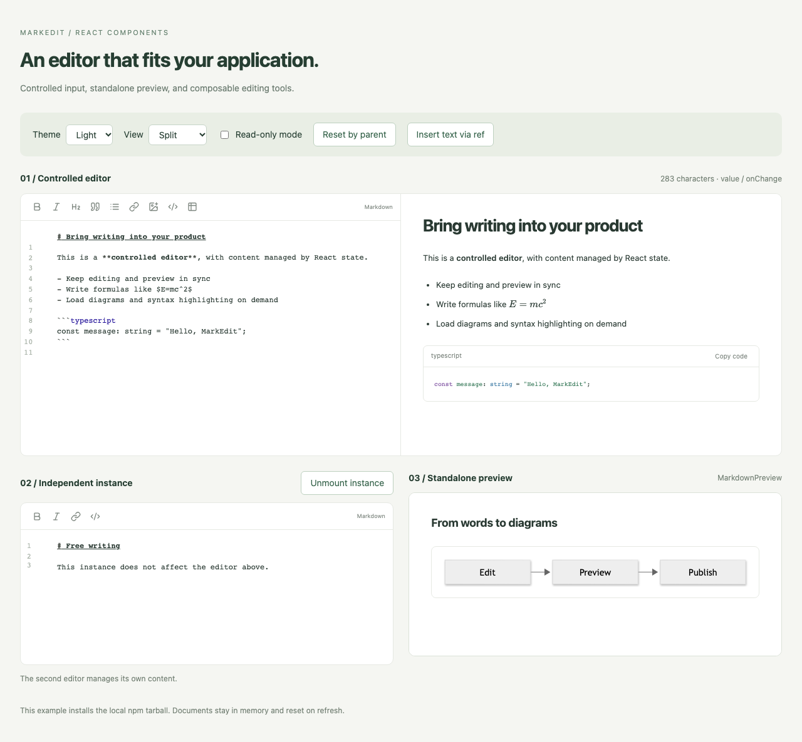

<div align="center">

# MarkEdit

**让写作保持专注，让 Markdown 拥有完整工作流。**

本地优先的 Markdown 工作台 · 可组合的 React 编辑器

[](https://github.com/honkinglin/MarkEdit/actions/workflows/ci.yml)
[](LICENSE)
[](packages/editor/README.md)
[](tsconfig.json)

[在线体验](https://markedit-seven.vercel.app) · [快速开始](#快速开始) · [React 组件](#react-组件) · [架构设计](project/ARCHITECTURE.md) · [参与贡献](CONTRIBUTING.md)

</div>



MarkEdit 将写作、预览、文档管理与版本恢复放在同一个工作台。无需注册，也无需配置后端，就能撰写技术笔记、维护 README，或整理带有公式与图表的长文。

它同时提供独立的 React 编辑器与预览组件：从个人写作空间到应用内的 Markdown 输入区域，复用同一套编辑能力。

## 为认真写作而设计

| 能力           | 体验                                                                               |
| -------------- | ---------------------------------------------------------------------------------- |
| **专注编辑**   | CodeMirror 6、格式工具栏、搜索替换、撤销重做；编辑、分屏、预览与专注模式自由切换。 |
| **表达完整**   | GFM 表格与任务列表、KaTeX 数学公式、Mermaid 图表、按需代码高亮。                   |
| **文档有序**   | 多文档管理、搜索、自动保存、回收站、版本快照与跨标签页同步。                       |
| **长文导航**   | 自动提取标题目录、唯一锚点、源码与预览标题跳转、双向滚动同步。                     |
| **数据可迁移** | Markdown 导入导出、工作区备份与恢复；备份导入创建独立副本。                        |
| **操作顺手**   | 命令菜单、键盘快捷键、深浅主题、可调分屏与窄屏布局。                               |

### 内容留在你的浏览器

工作台使用 IndexedDB 保存文档，无需账号或服务端存储。版本快照、回收站与可导出的备份，共同支持日常恢复和迁移。

文档不会自动同步到云端；清除站点数据会删除本地内容，请定期导出备份。正文中的外部图片仍会请求对应图片服务。

### 文字、代码、公式和图表，一起写

用 `$E=mc^2$` 写行内公式，用 `$$` 写块级公式，用 `mermaid` 围栏代码块表达流程与关系。代码高亮覆盖 JavaScript、TypeScript、Python、JSON、CSS、HTML/XML、Bash、SQL 和 Markdown。

直接导入[扩展语法示例](examples/extended-markdown.md)即可体验。原始 HTML 默认不渲染，图表使用受限配置并清理 SVG；单个图表出错时就地显示提示，正文继续可读。

## 快速开始

需要 **Node.js 24** 和 npm。

```bash
git clone https://github.com/honkinglin/MarkEdit.git
cd MarkEdit
npm ci
npm run dev
```

打开终端显示的本地地址，开始写作。生产构建使用 `npm run build`，静态产物输出到 `dist/`。

| 快捷键         | 操作                       |
| -------------- | -------------------------- |
| `⌘ / Ctrl + K` | 打开命令菜单               |
| `⌘ / Ctrl + S` | 保存当前文档               |
| `Esc`          | 关闭命令菜单或退出专注模式 |

Markdown 文件导入上限为 1 MB；工作区备份上限为 20 MB、1000 篇文档。备份包含历史版本和回收站内容。

## React 组件

将编辑器嵌入自己的产品，或者单独使用预览组件。组件不依赖工作台的文档仓库，也不接管宿主应用的数据持久化。

```tsx
import { useState } from 'react';
import { MarkdownEditor } from '@markedit/react';
import '@markedit/react/style.css';

export function WritingArea() {
  const [value, setValue] = useState('# Hello, MarkEdit');

  return <MarkdownEditor value={value} onChange={setValue} height={480} />;
}
```

**受控 / 非受控 · 独立预览 · 只读模式 · 实例级主题 · 工具栏配置 · CodeMirror 扩展 · 图片上传回调 · ref 命令**



组件包尚未发布 npm。目前可从仓库构建 tarball，或运行使用真实安装包的独立示例：

```bash
npm run example:setup
npm run example:dev
```

`example:setup` 会构建组件包并安装到示例项目。在其他 React 19 项目中，可安装生成的 `.benchmarks/markedit-react-0.1.0.tgz`。

查看[完整 API 与接入指南](packages/editor/README.md)，了解状态契约、扩展接口、样式导入与浏览器边界。图片上传由宿主应用通过 `uploadImage` 实现。

## 工程设计

- **清晰的模块边界：** 工作台负责文档生命周期，编辑器负责编辑事务，预览负责 Markdown 渲染；可复用组件独立打包。
- **稳定的组件契约：** TypeScript strict、显式 React peer dependencies、ESM 与类型声明、限定作用域的样式。
- **按需加载扩展：** 公式、图表与代码高亮拆分加载；大文档预览合并更新，源码输入独立响应。
- **可复现的验证：** 单元测试覆盖存储、编辑事务、安全与组件状态；Playwright 覆盖工作台和真实 tarball 消费流程。

最近一次本地验收通过 **51 项单元测试、24 项端到端测试**，覆盖 Chromium、Firefox、WebKit 与移动视口。完整环境、性能测量及覆盖边界见[验收记录](project/VALIDATION.md)；最新远端结果以顶部 CI 徽章为准。

```bash
# 格式、类型、单元测试、应用构建与组件产物检查
npm run check

# 跨浏览器用户流程
npm run example:setup
npm run example:build
npx playwright install chromium firefox webkit
npm run test:e2e

# 性能基准与产物 / 依赖许可报告
npm run benchmark
npm run release:report
```

## 路线与贡献

接下来持续打磨长文交互、依赖体积、真实输入法与移动设备体验，并推进组件包发布。当前不提供云同步、内置图片上传后端或离线 Service Worker；SSR 框架集成仍需单独验证。

欢迎通过 [Issues](https://github.com/honkinglin/MarkEdit/issues) 提交可复现的问题与使用场景，或按[贡献指南](CONTRIBUTING.md)参与改进。

[架构设计](project/ARCHITECTURE.md) · [开发路线图](project/ROADMAP.md) · [发布检查表](project/RELEASE.md) · [变更日志](CHANGELOG.md)

## License

[MIT](LICENSE)
