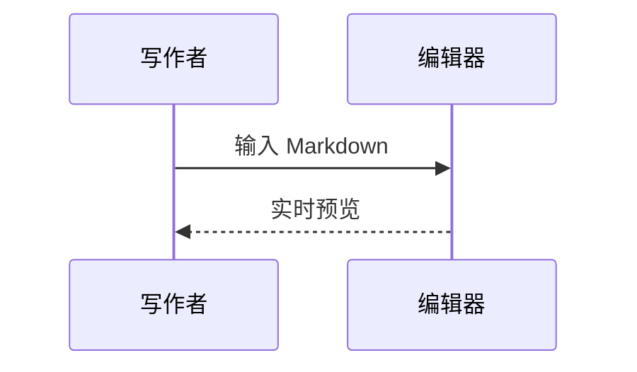

# Markdown，让表达更完整

## 数学公式

行内公式：$E = mc^2$。

$$
\int_0^1 x^2 \, dx = \frac{1}{3}
$$

## 流程图


## 时序图



## 代码高亮

```typescript
interface Note {
  title: string;
}
const note: Note = { title: 'Hello, MarkEdit' };
```

## 表格

| 能力         | 状态 |
| ------------ | ---- |
| 数学公式     | 可用 |
| Mermaid 图表 | 可用 |
| 代码高亮     | 可用 |

## 图片

使用工具栏的图片面板输入 HTTP(S) 图片地址。组件使用者可以传入 `uploadImage(file)` 接入自己的上传服务。
