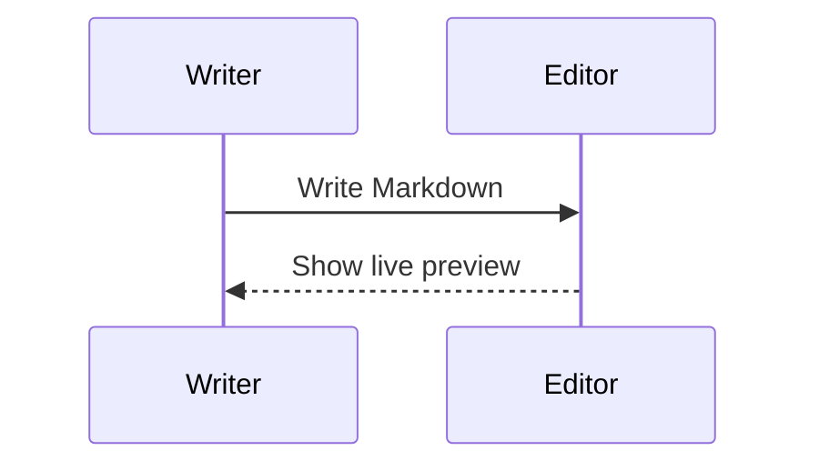

# More ways to express your ideas

## Math

An inline formula: $E = mc^2$.

$$
\int_0^1 x^2 \, dx = \frac{1}{3}
$$

## Flowchart


## Sequence diagram



## Syntax highlighting

```typescript
interface Note {
  title: string;
}
const note: Note = { title: 'Hello, MarkEdit' };
```

## Tables

| Capability          | Status    |
| ------------------- | --------- |
| Math formulas       | Available |
| Mermaid diagrams    | Available |
| Syntax highlighting | Available |

## Images

Use the image dialog in the toolbar to enter an HTTP(S) image URL. Applications embedding the component can supply `uploadImage(file)` to connect their own upload service.
