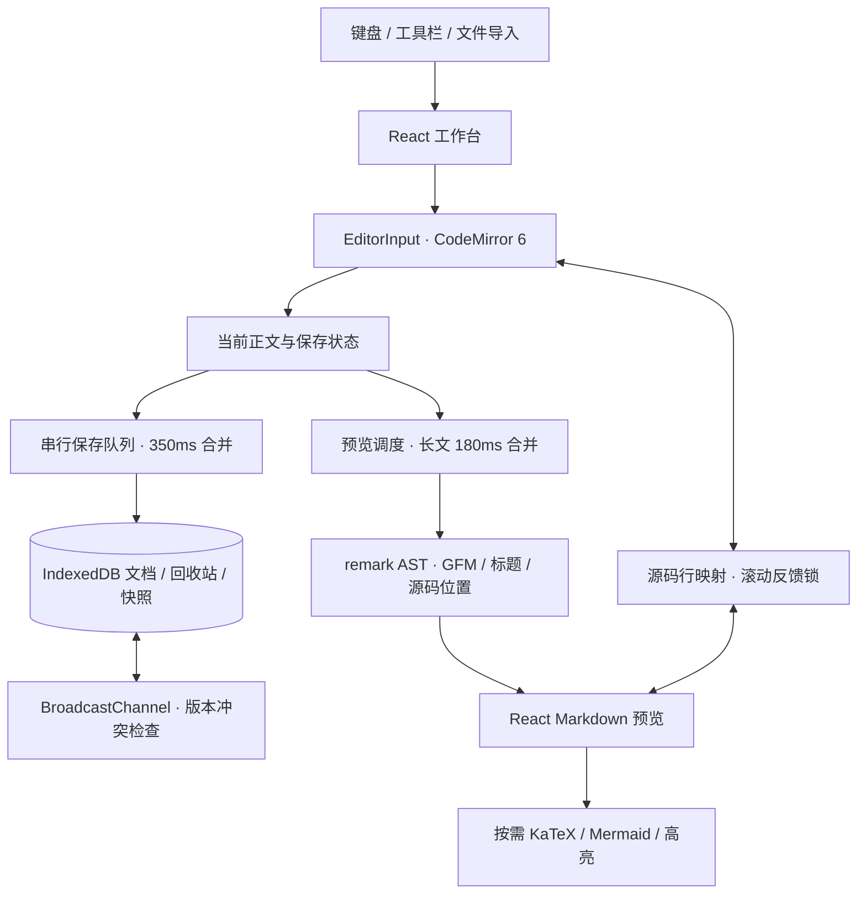

# MarkEdit 架构与工程决策

MarkEdit 将个人写作工作台与嵌入式 React 组件分开：前者负责文档安全，后者只负责编辑和渲染。

## 为什么保留 Markdown 源码编辑

目标用户主要写 README、技术笔记与博客。源码可移植、可版本管理，CodeMirror 提供成熟的选区、撤销、搜索与输入法基础。富文本双向转换和协作不是首版范围。

## 数据安全边界

编辑与保存解耦；写入串行执行，更新带版本号，切换文档先 flush。IndexedDB 事务保护批量恢复和版本写入；并发冲突让用户载入新版本或保存副本，不静默覆盖。错误时保留内存正文，允许导出。浏览器进程崩溃仍可能丢失尚未提交的一小段内容。

## 组件边界

公共 `MarkdownEditor` 管理受控契约与可选非受控状态；`EditorInput` 封装 CodeMirror；`MarkdownPreview` 只接收文本。包不读写工作台数据库。宿主提供图片上传回调，组件忽略卸载后的异步结果。公共对话框通过 portal 避免嵌套宿主 form。

React 是 peer dependency；独立项目消费真实 tarball 验证声明、CSS、字体和依赖。直接引用源码的 playground 无法发现漏打包文件，因此只作为开发方式，不作为发布验收依据。

## 不可信内容

默认跳过原始 HTML；公式关闭 trust；图表采用 strict 配置，禁用文档内配置并再次清理 SVG。外部图片仍产生网络请求，上传后端、权限和隐私策略由宿主负责。安全默认值不等于对任意第三方插件的安全担保。

## 性能取舍

延迟渲染不能中断同步 Markdown 解析，因此长文同时合并更新。公式与图表按需加载，但仍有较大的依赖 chunk；不把小型库入口误报为整个应用体积。基准测量与已知限制见 [开发路线图](ROADMAP.md)。增量解析、Worker 和虚拟化留作后续优化。
